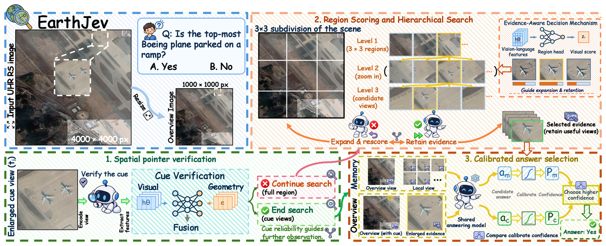

<div align="center">
<h1 align="center">EarthJev</h1>

<h3>EarthJev: Efficient Visual Evidence Acquisition and Decision for UHR Remote Sensing Understanding</h3>

Anonymous authors (under review)

[](#reference)  [](docs/INSTALL.md)  [](requirements/gpu.txt)  [](LICENSE)

[**Overview**](#overview) | [**Get Started**](#lets-get-started) | [**Results**](#results) | [**Common Issues**](#common-issues) | [**Reference**](#reference) | [**Acknowledgments**](#acknowledgments)

</div>

## 🛎Updates

* **` Nov. 2026`**: Code, trained weights, calibration runs and reference outputs of EarthJev are released, for the
  Qwen3.5-9B and Qwen3-VL-8B answering models!

## 🔭Overview

* **EarthJev** answers questions about ultra-high-resolution (UHR) remote sensing images with a frozen multimodal
  answering model. Three decision modules sit between observation and answering:
  * **Spatial pointer verification (SPV)** checks the boxes and points stated in a question and routes the question
    to a fast path or to the search;
  * the **evidence decision module (EDM)** scores image regions in batches with a region head on the answering
    model's hidden states and drives a hierarchical 3x3 search for at most four evidence views;
  * **calibrated answer selection (CAS)** answers from two presentations of the same views (visual memory and canvas)
    and keeps the answer with the higher calibrated confidence; an evidence presence veto corrects answers that deny
    visible evidence.

  Only the region head and the pointer verifier are trained, and the calibration maps and thresholds are fitted; the
  answering model never changes.

<p align="center">
  
</p>

* **Repository structure**

```
earthjev/        the method: pipeline.py (end to end), spv.py and pointers.py (SPV), region_head.py and search.py
                 (EDM), evidence.py, prompts.py, answerer.py and cas.py (presentations, answering, CAS), scoring.py
earthjev/train/  training of the region head and the pointer verifier, fitting of the decision parameters
configs/         the fitted parameters of each configuration (qwen35-9b, qwen3-vl-8b)
weights/         the trained region head and pointer verifier of each configuration
data/            question files, splits, image checksums and calibration runs (images are downloaded)
reference/       records of the original pipeline, to check a reproduction against
scripts/         prepare_data, check_env, run_earthjev, evaluate, check_live
docs/            INSTALL.md, DATA.md, TRAINING.md, PAPER_CODE_MAP.md
```

## 🗝Let's Get Started!

### `A. Installation`

The code runs on Linux with Python 3.12. Inference needs an NVIDIA GPU of the Ampere generation or newer with at
least 32 GB of memory and a driver for CUDA 12.8; the tests, the evaluation and the fitting run on CPU. Every step is
detailed in [docs/INSTALL.md](docs/INSTALL.md).

**Step 1: Clone the repository:**

```bash
git clone <repository URL> EarthJev
cd EarthJev
```

**Step 2: Create the environment** with [uv](https://docs.astral.sh/uv/):

```bash
uv venv --python 3.12.13 .venv
source .venv/bin/activate
uv pip install -r requirements/gpu.txt        # CPU only: uv pip install --torch-backend cpu -r requirements/cpu.txt
uv pip install --no-deps -e .
```

`requirements/gpu.txt` pins every package to the version behind the paper's numbers, including the official
flash-attn 2.8.1 and causal-conv1d 1.6.1 wheels (checked by sha256).

**Step 3: Set the paths and download WordNet** (for the official scorers):

```bash
export EARTHJEV_DATA=/data/earthjev/datasets      # benchmark images
export EARTHJEV_MODELS=/data/earthjev/models      # answering models
export EARTHJEV_OUT=$HOME/earthjev-outputs        # run outputs
export NLTK_DATA=/data/earthjev/nltk_data
export HF_HUB_OFFLINE=1 OMP_NUM_THREADS=1 MKL_NUM_THREADS=1 OPENBLAS_NUM_THREADS=1 TOKENIZERS_PARALLELISM=false
export NUMPY_MADVISE_HUGEPAGE=0
python -m nltk.downloader -d "$NLTK_DATA" wordnet omw-1.4
```

**Step 4: Check the installation:**

```bash
python scripts/check_env.py
python -m pytest -q -m "not data and not model"   # CPU tests, a few minutes
```

### `B. Download the Answering Models`

The trained EarthJev modules are in `weights/`. The frozen answering models are downloaded from Hugging Face at the
revisions the paper used:

```bash
HF_HUB_OFFLINE=0 hf download Qwen/Qwen3.5-9B --revision c202236235762e1c871ad0ccb60c8ee5ba337b9a \
    --local-dir "$EARTHJEV_MODELS/Qwen3.5-9B"
HF_HUB_OFFLINE=0 hf download Qwen/Qwen3-VL-8B-Instruct --revision 0c351dd01ed87e9c1b53cbc748cba10e6187ff3b \
    --local-dir "$EARTHJEV_MODELS/Qwen3-VL-8B-Instruct"      # only for the Qwen3-VL-8B configuration
python scripts/check_env.py --hash-model                     # sha256 of every model file
```

### `C. Data Preparation`

The five benchmarks, ***MME-RealWorld-RS, LRS-VQA, XLRS-Bench-lite, LRS-GRO and RSHR-Bench***, are downloaded from
Hugging Face at pinned revisions and converted by one script; `verify` checks every image against the sha256 in
`data/images.tsv`. The question files, splits and calibration runs come with the repository. Download links, terms
and manual downloads are in [docs/DATA.md](docs/DATA.md).

```bash
python scripts/prepare_data.py mme_rs xlrs_lite lrs_vqa lrs_gro rshr
python scripts/prepare_data.py verify
```

The images take 236 GiB (LRS-GRO links to the identical LRS-VQA images), and the downloads another 273 GiB, which can
be deleted after `verify`. LRS-VQA needs 7-Zip. The resulting layout:

```
${EARTHJEV_DATA}
├── MME-RealWorld/images/<index>.jpg      # e.g. 019871.jpg
├── LRS-VQA/LRS_VQA/image/<name>          # e.g. 15565.tif
├── XLRS-Bench-lite/images/<md5>.jpg
├── LRS-GRO/image/<name>                  # a link to ../LRS-VQA/LRS_VQA/image
├── RSHR-Bench/images/rshr_<id>.png|.jpg
├── ZwZ-RL-VQA/                           # training only: train.parquet, original_images/
└── sources/                              # the downloads
```

### `D. Inference`

```bash
python scripts/run_earthjev.py --bench mme_rs                       # one GPU, the whole benchmark

for i in $(seq 1 8); do                                             # or 8 shards on 8 GPUs
  CUDA_VISIBLE_DEVICES=$((i-1)) python scripts/run_earthjev.py --bench mme_rs --shard $i/8 --resume &
done; wait
```

**`Parameter guide`**:
- `--bench`: `mme_rs`, `lrs_vqa`, `xlrs_lite`, `lrs_gro` or `rshr`.
- `--config`: `qwen35-9b` (default) or `qwen3-vl-8b`.
- `--shard i/n`: the i-th of n contiguous chunks of the questions sorted by image.
- `--resume` / `--overwrite`: continue or replace an existing output file; a non-empty output is refused otherwise.
- `--limit N`: only the first N questions, for a quick trial.
- `--out`: the output file, by default `$EARTHJEV_OUT/earthjev_<config>/<bench>_full_<i>of<n>.jsonl`.

Each question gives one JSON line: the route, the pointer trust, the evidence views, both answers with their
log-probs, the chosen presentation and its calibrated confidence, the veto, the final answer and the stage timings.

### `E. Evaluation`

```bash
python scripts/evaluate.py $EARTHJEV_OUT/earthjev_qwen35-9b/mme_rs_full_1of1.jsonl
python scripts/evaluate.py $EARTHJEV_OUT/earthjev_qwen35-9b/mme_rs_full_*of8.jsonl        # the 8 shards
python scripts/evaluate.py $EARTHJEV_OUT/earthjev_qwen3-vl-8b/mme_rs_full_1of1.jsonl --config qwen3-vl-8b
```

`evaluate.py` prints the official scores per benchmark and question group next to the paper's. To check a
reproduction question by question, run the first shard of each benchmark and compare it with the records of the
original pipeline in `reference/live/<config>/` ([reference/README.md](reference/README.md) gives the agreement to
expect):

```bash
for s in mme_rs:12 lrs_vqa:24 xlrs_lite:10 lrs_gro:32 rshr:3; do
  python scripts/run_earthjev.py --bench ${s%:*} --shard 1/${s#*:}
done
O=$EARTHJEV_OUT/earthjev_qwen35-9b
python scripts/check_live.py $O/mme_rs_full_1of12.jsonl $O/lrs_vqa_full_1of24.jsonl $O/xlrs_lite_full_1of10.jsonl \
    $O/lrs_gro_full_1of32.jsonl $O/rshr_full_1of3.jsonl
```

For Qwen3-VL-8B, add `--config qwen3-vl-8b` to every command and use `O=$EARTHJEV_OUT/earthjev_qwen3-vl-8b`.

### `F. Training`

```bash
python -m earthjev.train.zwz export && python -m earthjev.train.zwz build      # ZwZ-RL-VQA region annotations
python -m earthjev.train.extract_features --set zwz                            # GPU: answering-model features
python -m earthjev.train.train_region_head                                     # region head
python -m earthjev.train.train_verifier zv && python -m earthjev.train.train_verifier train   # pointer verifier
python -m earthjev.train.fit_decisions                                         # calibration maps and thresholds
```

Every step except `zwz` takes `--config qwen3-vl-8b`. `fit_decisions` runs on CPU and reproduces the fitted
parameters of `configs/<config>.json` bitwise from the calibration runs in `data/calibration/<config>`. What each step
reads and writes, how to chain retrained weights, and what is reproduced exactly: [docs/TRAINING.md](docs/TRAINING.md).

## ⚗Results

EarthJev accuracy (%) on the full benchmark sets, as reported in the paper (`reference/paper_scores.json`):

| Answering model | `--config` | MME-RS | LRS-VQA | XLRS-lite | LRS-GRO | RSHR-Bench | Mean |
| :---: | :---: | :---: | :---: | :---: | :---: | :---: | :---: |
| Qwen3.5-9B | `qwen35-9b` | 63.16 | 34.79 | 55.81 | 59.27 | 52.25 | 53.06 |
| Qwen3-VL-8B | `qwen3-vl-8b` | 56.39 | 34.97 | 54.38 | 59.40 | 49.48 | 50.92 |

* *The paper's numbers come from the logged runs of the original pipeline. A live run of this code answers the same
  questions with the same algorithm: on the 1,612 reference questions, the correctness of the original pipeline's
  live answers equals that of the paper's answers on 99.0-100% of the questions per benchmark.*
* *On a full NVIDIA H100 with the pinned stack, the reference records should reproduce exactly. Other GPUs round the
  bf16 kernels differently and change some answers: on an H100 MIG partition, 88% of the Qwen3.5-9B final answers on
  the 1,612 questions were identical, and the accuracy differed by +0.37 points.*
* *How each part of the paper maps to the code: [docs/PAPER_CODE_MAP.md](docs/PAPER_CODE_MAP.md).*

## 🤔Common Issues

| Issue | Solution |
| :--- | :--- |
| The flash-attn or causal-conv1d wheel does not install (glibc older than 2.32, another CUDA) | Build them from source, [docs/INSTALL.md](docs/INSTALL.md) section 3.4; section 3.5 explains running without them |
| `RuntimeError: set the environment variable EARTHJEV_DATA` (or `EARTHJEV_MODELS`) | Set the paths of `A. Installation`, Step 3 |
| `run_earthjev.py: error: ... is not empty` | Add `--resume` to continue the run, or `--overwrite` to replace it |
| `check_live.py` reports differences on a GPU other than the H100 | Expected: compare benchmark accuracies instead ([reference/README.md](reference/README.md)) |
| `fit_decisions` says "up to floating-point rounding" | CPUs without AVX-512 round NumPy's `exp` and `log` differently in the last bits; the result is accepted ([docs/INSTALL.md](docs/INSTALL.md) section 9) |
| `hf download` fails with HTTP 429 or a timeout | Rerun the same command, which resumes; a Hugging Face token raises the rate limit |

## 📜Reference

If this code is useful for your research, please consider citing our paper. The BibTeX entry will be added after
the review.

## 🤝Acknowledgments

This project builds on Vision-Jev ([code](https://github.com/LMDHQ-0420/Vision-Jev)), VISTA
([paper](https://arxiv.org/abs/2610.02200), [code](https://github.com/joshhhhhan/VISTA)) and ZoomSearch
([paper](https://arxiv.org/abs/2511.20460), [code](https://github.com/kiki-zyq/ZoomSearch)). It uses the
[Qwen3.5-9B](https://huggingface.co/Qwen/Qwen3.5-9B) and [Qwen3-VL-8B-Instruct](https://huggingface.co/Qwen/Qwen3-VL-8B-Instruct)
models, the [ZwZ-RL-VQA](https://huggingface.co/datasets/inclusionAI/ZwZ-RL-VQA) data, the benchmarks
[MME-RealWorld](https://github.com/MME-Benchmarks/MME-RealWorld), [LRS-VQA](https://github.com/VisionXLab/LRS-VQA),
[XLRS-Bench](https://github.com/AI9Stars/XLRS-Bench), LRS-GRO ([ZoomEarth](https://github.com/earth-insights/ZoomEarth))
and RSHR-Bench ([paper](https://arxiv.org/abs/2512.17319), [code](https://github.com/Yunkaidang/RSHR)), and the
official evaluation code of these benchmarks and of [lmms-eval](https://github.com/EvolvingLMMs-Lab/lmms-eval).
Thanks for their excellent works! Reused code and its licenses are listed in
[THIRD_PARTY_NOTICES.md](THIRD_PARTY_NOTICES.md), and the terms of the data in [docs/DATA.md](docs/DATA.md).

The code, `configs/` and `weights/` are released under the [Apache License 2.0](LICENSE); the benchmark-derived data
keep the terms of their sources.

## 🙋Q & A

***For questions, please open an issue in this repository.***
